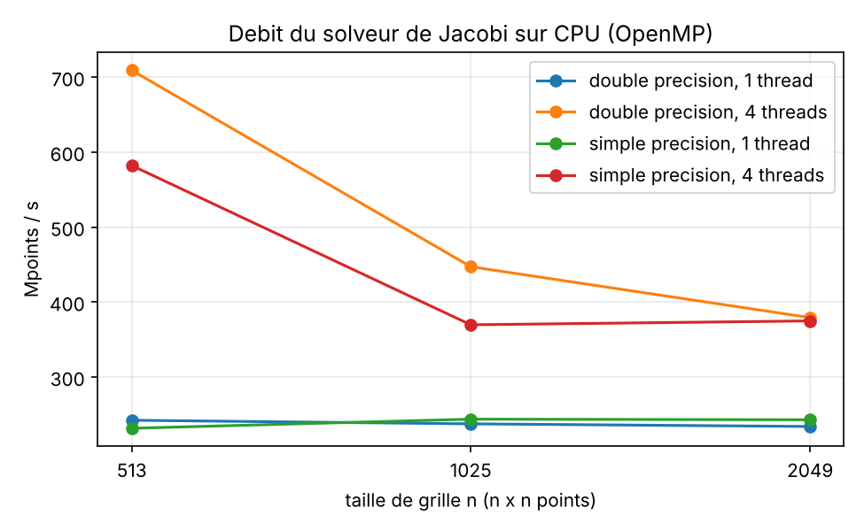
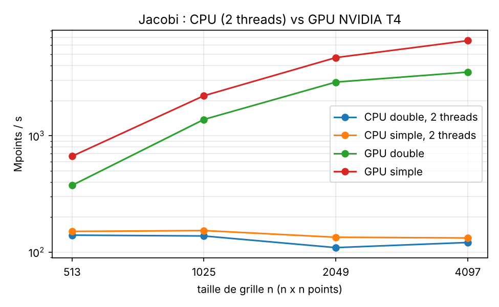

# Poisson 2D en Fortran — OpenMP et GPU

Solveur de Jacobi en Fortran moderne pour l'équation de Poisson 2D, vérifié sur solution exacte, parallélisé avec OpenMP sur CPU et porté sur GPU NVIDIA avec OpenMP offload (jusqu'à ×29 en double précision et ×54 en simple précision sur un GPU T4).

## Problème

```
-Δu = f   sur [0,1]²,   u = 0 au bord
```

Solution exacte : `u(x,y) = sin(πx)·sin(πy)`, donc `f = 2π²·sin(πx)·sin(πy)`.

## Méthode

- Différences finies, stencil à 5 points, grille de n × n points, pas `h = 1/(n-1)`
- Méthode itérative de Jacobi : `v(i,j) = (u(i-1,j) + u(i+1,j) + u(i,j-1) + u(i,j+1) + h² f(i,j)) / 4`
- Arrêt quand l'écart maximal entre deux itérations passe sous `tol`
- Erreur de discrétisation attendue en O(h²)
- Parallélisation CPU : `!$omp parallel do collapse(2)` avec `reduction(max:ecart)`
- Précision choisie à la compilation : double par défaut, simple avec `-DSINGLE` (module `precision`)

Jacobi est un calcul de stencil limité par la bande passante mémoire : chaque point lu sert à peu d'opérations. C'est le cas typique qui se parallélise bien, sur CPU comme sur GPU.

## Structure

```
src/precision.F90     # choix simple / double précision
src/solveur.F90       # initialisation, Jacobi (CPU et GPU), erreur L2
src/convergence.F90   # étude de convergence + test (échoue si l'ordre n'est pas 2)
src/performance.F90   # temps par itération à nombre d'itérations fixe (CPU et GPU)
scripts/mesures.sh    # campagne de mesures CPU
scripts/courbes.py    # tracé des courbes
colab_gpu.ipynb       # compilation et mesures GPU sur Google Colab
.github/workflows/    # intégration continue : compilation + test à chaque push
```

## Utilisation

```bash
sudo apt install gfortran make python3-matplotlib python3-pandas
make && make simple
mkdir -p results
make test                  # étude de convergence, vérifie l'ordre 2
bash scripts/mesures.sh    # mesures de performance CPU
python3 scripts/courbes.py # courbes dans results/
```

## Résultats

Mesures CPU (sections 1 et 2) sur un Mac à puce Apple Silicon, dans une machine virtuelle Ubuntu 24.04 ARM (QEMU) à 4 cœurs, gfortran, `-O3 -march=native`.

### 1. Vérification sur solution exacte

| n | h | itérations | erreur L2 | ordre observé |
|---|---|---|---|---|
| 17 | 6,25 × 10⁻² | 1 222 | 1,52 × 10⁻³ | — |
| 33 | 3,13 × 10⁻² | 4 621 | 3,90 × 10⁻⁴ | 1,96 |
| 65 | 1,56 × 10⁻² | 17 350 | 9,89 × 10⁻⁵ | 1,98 |
| 129 | 7,81 × 10⁻³ | 64 814 | 2,49 × 10⁻⁵ | 1,99 |

L'erreur est divisée par 4 quand h est divisé par 2 : l'ordre 2 est retrouvé. Le nombre d'itérations, lui, est multiplié par environ 4 : Jacobi converge en O(n²) itérations, ce qui le rend lent sur les grands maillages (d'où l'intérêt du gradient conjugué ou du multigrille).


### 2. Performance sur CPU (500 itérations, temps par itération)

| précision | threads | n = 513 | n = 1 025 | n = 2 049 |
|---|---|---|---|---|
| double | 1 | 1,08 ms | 4,41 ms | 17,9 ms |
| double | 4 | 0,37 ms | 2,34 ms | 11,1 ms |
| simple | 1 | 1,13 ms | 4,29 ms | 17,3 ms |
| simple | 4 | 0,45 ms | 2,83 ms | 11,2 ms |

- **OpenMP sur 4 cœurs : ×2,9 pour n = 513, mais seulement ×1,9 pour n = 1 025 et ×1,6 pour n = 2 049.** Les trois tableaux (u, v, f) occupent environ 6 Mo pour n = 513 et 100 Mo pour n = 2 049 : sur les grandes grilles, ils doivent être relus en mémoire vive à chaque itération, et les 4 cœurs se partagent la même bande passante mémoire. C'est le comportement attendu d'un calcul limité par la mémoire.
- **Simple précision : pas de gain mesuré sur cette machine** (temps équivalents, voire plus lents sur 4 threads pour n = 513). Sur GPU en revanche, la simple précision va 1,9 fois plus vite (voir la section 3).



### 3. Portage GPU (OpenMP offload)

Exécuté sur Google Colab avec un GPU **NVIDIA Tesla T4**, compilateur `nvfortran` 26.9 (NVIDIA HPC SDK), via le notebook `colab_gpu.ipynb`.

- `!$omp target teams distribute parallel do collapse(2)` sur les boucles de calcul ;
- une région `!$omp target data` garde `u`, `f` et `v` sur le GPU pendant toutes les itérations : sans elle, chaque itération recopierait les tableaux entre CPU et GPU.

**Vérification :** l'étude de convergence exécutée sur GPU (`make gpu_test`) donne exactement les mêmes erreurs que sur CPU (ordre 1,96 → 1,99). Les lancements de noyaux sont visibles avec `NVCOMPILER_ACC_NOTIFY=1`.

**Performance** (500 itérations, temps par itération ; référence : CPU de la même machine Colab, 2 threads OpenMP) :

| version | n = 513 | n = 1 025 | n = 2 049 | n = 4 097 |
|---|---|---|---|---|
| CPU double, 2 threads | 1,87 ms | 7,61 ms | 38,4 ms | 139 ms |
| CPU simple, 2 threads | 1,74 ms | 6,84 ms | 31,3 ms | 127 ms |
| GPU double | 0,70 ms (×2,7) | 0,76 ms (×10) | 1,45 ms (×26) | 4,77 ms (×29) |
| GPU simple | 0,39 ms (×4,8) | 0,48 ms (×16) | 0,89 ms (×43) | 2,56 ms (×54) |

- **Le GPU n'est rentable que sur les grandes grilles.** Pour n = 513, il n'y a pas assez de points pour occuper le GPU, et le temps est dominé par des coûts fixes : lancement de trois noyaux et rapatriement du critère d'arrêt à chaque itération, initialisation du GPU incluse dans la mesure.
- **Sur GPU, la simple précision est 1,9 fois plus rapide que la double pour n = 4 097**, proche du facteur 2 attendu : Jacobi est limité par la bande passante mémoire, et un réel simple fait 4 octets au lieu de 8. Sur le CPU de Colab, le gain n'est que de 1,1.
- Débit mémoire estimé pour n = 4 097 : environ 130 à 140 Go/s (environ 40 octets lus ou écrits par point et par itération), soit un peu moins de la moitié des 320 Go/s théoriques du T4.



## Limites et suites

- Jacobi converge lentement (O(n²) itérations) : gradient conjugué ou multigrille ensuite.
- Mesures dans une machine virtuelle à 4 cœurs : scalabilité à confirmer sur un cluster.
- Simple précision : mesurer aussi la perte de précision sur l'erreur finale.
- GPU : supprimer la boucle de recopie `u = v` (échange de pointeurs) pour réduire le trafic mémoire, ne calculer le critère d'arrêt que toutes les k itérations, et exclure l'initialisation du GPU de la mesure.

## Auteur

Salifou Abdou Sakirou — Master CHPS (Calcul Haute Performance et Simulation), Université de Perpignan Via Domitia
