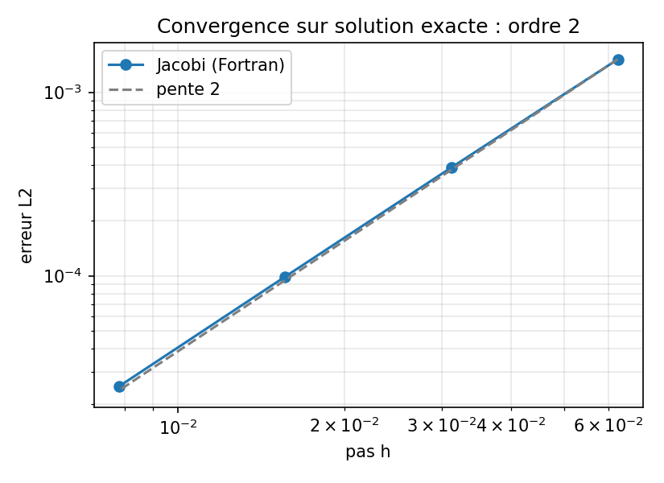

# Poisson 2D en Fortran — OpenMP et GPU

Solveur de Jacobi en Fortran moderne pour l'équation de Poisson 2D, vérifié sur solution exacte, parallélisé avec OpenMP sur CPU, avec un portage GPU (OpenMP offload) en cours.

## Problème

```
-Δu = f   sur [0,1]²,   u = 0 au bord
```

Solution exacte : `u(x,y) = sin(πx)·sin(πy)`, donc `f = 2π²·sin(πx)·sin(πy)`.

## Méthode

- Différences finies, stencil à 5 points, grille de n × n points, pas `h = 1/(n-1)`
- Méthode itérative de Jacobi : `u_new(i,j) = (u(i-1,j) + u(i+1,j) + u(i,j-1) + u(i,j+1) + h² f(i,j)) / 4`
- Arrêt quand l'écart maximal entre deux itérations passe sous `tol`
- Erreur de discrétisation attendue en O(h²)
- Parallélisation CPU : `!$omp parallel do collapse(2)` avec `reduction(max:ecart)`
- Précision choisie à la compilation : double par défaut, simple avec `-DSINGLE` (module `precision`)

Jacobi est un calcul de stencil limité par la bande passante mémoire : chaque point lu sert à peu d'opérations. C'est le cas typique qui se parallélise bien, sur CPU comme sur GPU.

## Structure

```
src/precision.F90     # choix simple / double précision
src/solveur.F90       # initialisation, Jacobi (CPU et GPU), erreur L2
src/convergence.F90   # étude de convergence + test (échoue si l'ordre n'est pas 2)
src/performance.F90   # temps par itération à nombre d'itérations fixe
scripts/mesures.sh    # campagne de mesures CPU
scripts/courbes.py    # tracé des courbes
colab_gpu.ipynb       # compilation et mesures GPU sur Google Colab
.github/workflows/    # intégration continue : compilation + test à chaque push
```

## Utilisation

```bash
sudo apt install gfortran make python3-matplotlib python3-pandas
make && make simple
mkdir -p results
make test                  # étude de convergence, vérifie l'ordre 2
bash scripts/mesures.sh    # mesures de performance CPU
python3 scripts/courbes.py # courbes dans results/
```

## Résultats

Mesures sur une machine Linux à 2 cœurs (Intel Xeon 2,8 GHz), gfortran 13.3, `-O3 -march=native`.

### 1. Vérification sur solution exacte

| n | h | itérations | erreur L2 | ordre observé |
|---|---|---|---|---|
| 17 | 6,25 × 10⁻² | 1 222 | 1,52 × 10⁻³ | — |
| 33 | 3,13 × 10⁻² | 4 621 | 3,90 × 10⁻⁴ | 1,96 |
| 65 | 1,56 × 10⁻² | 17 350 | 9,89 × 10⁻⁵ | 1,98 |
| 129 | 7,81 × 10⁻³ | 64 814 | 2,49 × 10⁻⁵ | 1,99 |

L'erreur est divisée par 4 quand h est divisé par 2 : l'ordre 2 est retrouvé. Le nombre d'itérations, lui, est multiplié par environ 4 : Jacobi converge en O(n²) itérations, ce qui le rend lent sur les grands maillages (d'où l'intérêt du gradient conjugué ou du multigrille).



### 2. Performance sur CPU (500 itérations)

| précision | threads | n = 513 | n = 1 025 | n = 2 049 |
|---|---|---|---|---|
| double | 1 | 1,70 ms/it | 7,14 ms/it | 27,6 ms/it |
| double | 2 | 0,84 ms/it | 3,76 ms/it | 15,0 ms/it |
| simple | 1 | 1,44 ms/it | 6,04 ms/it | 24,8 ms/it |
| simple | 2 | 0,77 ms/it | 3,17 ms/it | 11,8 ms/it |

- OpenMP sur 2 cœurs : accélération de 1,8 à 2,0 selon la taille.
- Simple précision : de 1,1 à 1,3 fois plus rapide que la double. Les réels font 4 octets au lieu de 8, donc moins de données à transférer depuis la mémoire, cohérent avec un calcul limité par la bande passante.


### 3. GPU — en cours

Le portage GPU est écrit avec OpenMP offload (`make gpu`, compilateur `nvfortran` du NVIDIA HPC SDK) :

- `!$omp target teams distribute parallel do collapse(2)` sur les boucles de calcul ;
- une région `!$omp target data` garde `u`, `f` et `unew` sur le GPU pendant toutes les itérations. Sans elle, chaque itération recopierait les tableaux entre CPU et GPU, et le transfert coûterait plus cher que le calcul.

Cette version n'a pas encore été exécutée sur GPU : les résultats seront ajoutés après les tests. Le notebook `colab_gpu.ipynb` installe le compilateur, vérifie l'ordre 2 sur GPU (`make gpu_test`) et compare CPU et GPU sur Google Colab (GPU T4).

## Limites et suites

- Jacobi converge lentement (O(n²) itérations) : gradient conjugué ou multigrille ensuite.
- Mesures sur 2 cœurs seulement : scalabilité à étendre sur un cluster.
- Simple précision : mesurer aussi la perte de précision sur l'erreur finale.

## Auteur

Salifou Abdou Sakirou — Master CHPS (Calcul Haute Performance et Simulation), Université de Perpignan Via Domitia
